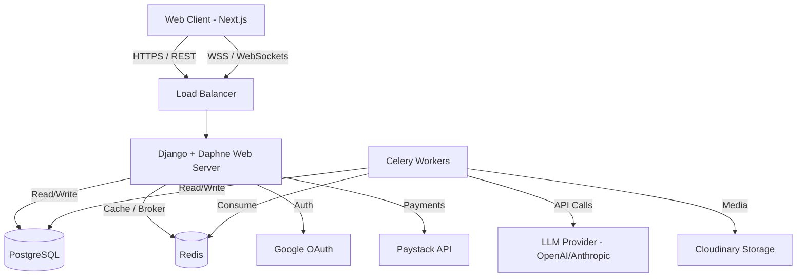

# Emby - Technical Architecture Document

## 1. Introduction
This document outlines the technical architecture of the Emby Quiz Examination System. Emby is a modern, full-stack educational platform providing assessment, AI-powered evaluation, practice modules, and a comprehensive administrative dashboard. The system is designed for high performance, scalability, and asynchronous processing capabilities.

## 2. System Overview
The architecture follows a decoupled client-server model.
- **Frontend Client:** A Next.js 16 (App Router) Single Page Application (SPA) providing interfaces for students (Web App) and administrators (Admin Dashboard).
- **Backend Service:** A Django 4.x monolith serving RESTful APIs via Django REST Framework (DRF) and real-time WebSockets via Django Channels (Daphne).
- **Asynchronous Workers:** Celery workers backed by Redis for offloading heavy tasks (AI grading, slide processing, RAG indexing).
- **Data Persistence:** PostgreSQL for relational data and Redis for caching and message brokering.

## 3. High-Level Architecture Diagram

## 4. Frontend Architecture (Next.js)
### 4.1. Core Technologies
- **Framework:** Next.js 16 with Turbopack (App Router `app/` directory).
- **Language:** TypeScript for end-to-end type safety.
- **State Management:** A hybrid approach using **Zustand** (e.g., `store/quiz-attempt-slice.ts` for lightweight UI state) and **Redux Toolkit** for complex global application state.
- **Styling & UI:** Tailwind CSS, Radix UI primitives (shadcn/ui), and Framer Motion for micro-animations.
- **Forms & Validation:** React Hook Form integrated with Zod.

### 4.2. Routing Structure
- `(app)`: The core student-facing application (Dashboards, Quizzes, Practice, Credits).
- `(admin)`: Administrative dashboard for curriculum management, user control, and payment tracking. Built with dynamic schema generation (fetching Django models dynamically to render admin tables).
- **Auth Routes:** Modularized authentication flows (`/signin`, `/signup`, `/forgot-password`, `/verification-pending`).

## 5. Backend Architecture (Django)
### 5.1. Core Technologies
- **Framework:** Django 4.x with Django REST Framework.
- **ASGI Server:** Daphne for handling asynchronous protocols (WebSockets) alongside HTTP.
- **Task Queue:** Celery for distributed task execution.

### 5.2. Modular App Structure
- `accounts`: User modeling, profile management, JWT, and Google OAuth integration.
- `curriculum`: Hierarchical data models (Subjects -> Blocks -> Topics) for organizing educational content.
- `learning`: Managing slides and educational content, incorporating Retrieval-Augmented Generation (RAG).
- `pastquestions`: Question bank management (MCQs, Theory).
- `credits`: Managing user API usage limits, tracking free-tier usage versus premium.
- `payments`: Webhook integrations with Paystack for subscription lifecycle management.

### 5.3. Asynchronous Task Processing (Celery)
Heavy operations are strictly offloaded from the main HTTP thread to Celery workers:
- **AI Grading:** Theory question evaluations using external LLM APIs (with primary and fallback API keys).
- **Slide Processing:** Extracting content from PDFs, generating embeddings for RAG (`fix_slide.py`, `check_slide.py`).
- **Data Backfills:** Scheduled jobs for maintaining data integrity.

## 6. Data Architecture
### 6.1. Primary Database (PostgreSQL)
A relational schema designed for high-integrity transactions:
- **Users & Auth:** Extended AbstractUser model linked to Profiles.
- **Curriculum Tree:** Self-referential or deeply nested foreign keys linking Subjects > Blocks > Topics.
- **Assessments:** `QuizAttempt` acts as the root aggregate holding state (`in_progress`, `graded`). It links to individual `QuestionAttempt` records.
- **Transactions:** Audit logs for credit expenditure and Paystack payments.

### 6.2. Caching & Message Broker (Redis)
- **Celery Broker:** Queuing tasks for background processing.
- **Channel Layer:** Facilitating real-time WebSocket communication via Django Channels.
- **Rate Limiting:** Tracking API usage (e.g., 10 quiz creations/hour/user).

## 7. Key System Flows
### 7.1. Quiz Attempt Lifecycle
1. **Initialization:** Client POSTs `/quiz-attempts/`. Django validates subscription limits (Free vs Premium) via the `credits` app.
2. **Generation:** Backend queries the `pastquestions` and `curriculum` apps to assemble MCQs and Theory questions based on requested difficulty and topic.
3. **Execution:** Client submits answers incrementally via REST endpoints. State is maintained in Next.js via Zustand.
4. **Submission:** Manual or Auto-submission triggers a state change to `graded`.
5. **Evaluation:** MCQs are evaluated synchronously. Theory questions trigger an asynchronous Celery task to call the LLM API.
6. **Result Retrieval:** Client polls or receives a WebSocket event upon theory grading completion.

### 7.2. Payment & Subscription Flow
1. Client initiates upgrade via Paystack checkout.
2. Paystack processes payment and fires a secure webhook to the Django backend.
3. The `payments` app verifies the webhook signature.
4. Upon validation, the user's `Profile` is upgraded to Premium, unlocking detailed AI analysis and higher rate limits.

## 8. Security & Compliance
- **Authentication:** Stateless JWT tokens passed via Authorization headers.
- **Authorization:** Role-Based Access Control (RBAC). `is_staff` and `is_superuser` flags control access to the dynamic Next.js admin dashboard.
- **API Protection:** DRF throttling limits endpoints to prevent abuse (e.g., 100 answers/min/user).
- **Data Privacy:** Passwords hashed via PBKDF2. Environment variables strictly separate development and production secrets.

## 9. Infrastructure & Deployment (Render + Vercel)
- **Frontend (Vercel):** Serverless deployment configured via `vercel.json` and standard Next.js build pipeline.
- **Backend (Render):** Defined by `render.yaml`.
  - `web`: Python runtime running Daphne (HTTP + WSS).
  - `worker`: Python runtime running Celery.
  - `redis`: Managed Redis instance linked to both web and worker.
  - `PostgreSQL`: Render Managed Database.
- **Storage:** Cloudinary integration for scalable image, PDF, and media asset storage.

## 10. Future Architectural Considerations
- **GraphQL:** Transitioning complex frontend curriculum fetching to GraphQL to reduce over-fetching.
- **Vector Database:** Migrating RAG embeddings from pgvector/in-memory to a dedicated vector store (Pinecone/Weaviate) as slide volume scales.
- **Microservices:** Extracting the AI grading engine into a dedicated microservice (e.g., FastAPI) if LLM context processing becomes a bottleneck.
